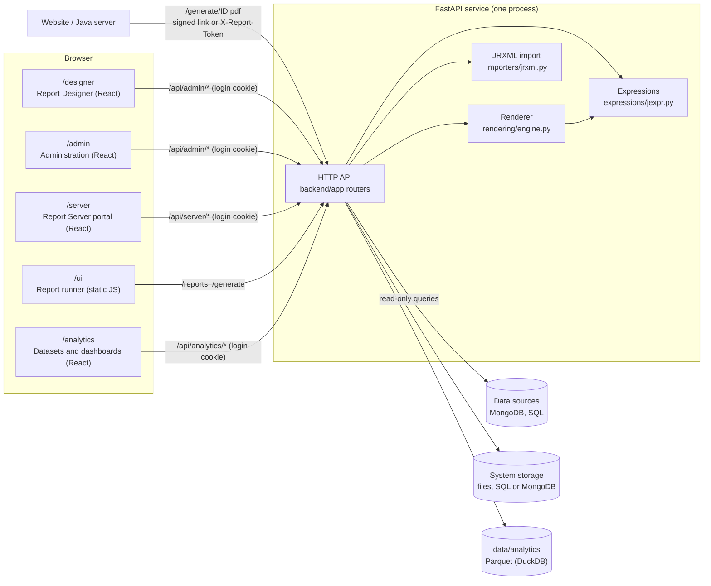

# Architecture — Analysis

**Analysis** (default product name; Admin → Branding renames it) is a Jaspersoft Studio + JasperReports Server
style reporting product with Power BI–style analytics, written in **Python (FastAPI)** and **React**. Designers
build band-based reports in the browser, save them in their own workspace, publish them to a server repository,
and users or other systems run them as PDF, Excel or CSV. Analytics imports query results into Parquet datasets
and shows them on dashboards.

This document explains **what every part is, why it exists and how the parts work together**, for the backend
and frontend teams. Keep it up to date when the structure changes.

---

## 1. The big picture



| Jaspersoft product | Here | Purpose |
|---|---|---|
| Jaspersoft Studio | `/designer` | Build reports: bands, elements, palette, outline, properties, query, preview, source |
| Workspace / project folder | `data/workspace/` | The designer's drafts. Saving never changes the server |
| JasperReports Server repository | `data/reports/` + `/server` | Published reports in folders; run, edit properties, copy/move, history |
| JRXML file | `.mrd` file | One file with the whole report (query, parameters, adapter, design, images) |
| Data Adapter | `data/connections.json` + `data/private_secrets.json` | Named database connections; secrets kept apart |
| JasperReports Library (Java) | `rendering/engine.py` + `expressions/jexpr.py` | Fills the design with data and draws PDF / Excel / CSV |

---

## 2. Repository layout

```text
backend/app/               The service (Python package); start: `uvicorn backend.app.main:app` — see §3
frontend/                  React source (Vite, several pages) — see §4
  index.html, server.html, admin.html, analytics.html   page entry points → built into ui/app/
  src/ (designer)  src/server/  src/admin/  src/analytics/  src/portal/ (page shell)  src/shared/ (theme, nav,
  folders, adapters)
ui/                        What the service serves: app/ (built React pages), index.html + runner.* (/ui, plain JS),
                           embed/ (embed SDK and viewer), brand/ (logo, favicon, theme)
tests/                     pytest suite (≈430 tests), JRXML fixture, service_names.py (every module's names in one
                           namespace, for the older tests)
postman/                   Collection + environment for every endpoint (Admin → Tools offers them for download)
tools/                     postman/ (collection builder, demo data), embed/ (example page), theme/ (runner dark CSS)
deploy/                    docker-compose.yml (PostgreSQL + 2 instances + nginx HTTPS), nginx.conf
data/                      Runtime data — never in git or in the Docker image (see §6)
.github/workflows/ci.yml   CI: ruff + pytest (with PostgreSQL, MySQL, MongoDB, SQL Server, Oracle), frontend build,
                           Docker build and start
pyproject.toml             Project metadata, ruff (lint) and pytest settings
requirements*.txt          Runtime / development dependencies
Dockerfile, .dockerignore  Multi-stage image: builds the frontend, then the Python service (no data inside)
docs/SETTINGS.md           Every setting with a comment (.env is made by python -m backend.app.setup and never committed)
README.md, ARCHITECTURE.md, DEPLOYMENT.md, TESTING.md, README_roman_urdu.md   Documentation
```

---

## 3. Backend (`backend/app`)

```text
backend/app/
  main.py                  `app = make_app()` — the ASGI entry point
  factory.py               make_app(): builds the context, the FastAPI app, the access/log middleware, then each router
  context.py               create_context(): start-up work and shared state (settings, repository cache, Mongo clients),
                           then binds the service functions onto ctx
  services/                the helpers the routers share; each function takes ctx first
    guards.py              report access (signed links / token), admin/designer tokens, /server sessions, JSON bodies
    connections.py         Mongo clients, adapter kind, SQL adapters, connection tests (all adapter types)
    runs.py                run a report (MongoDB pipeline or SQL), subreports, drafts, previews, files
    repository.py          save/delete/copy reports and folders, summaries, the /server resource page
    workspace.py           designer drafts and their publish status
    history.py             history of each server report
    versions.py            every saved version of a server report; the repository revision (several instances)
    access.py              folder permissions applied to /server, schedules and subreports
    accounts.py            /admin user helpers
  routers/                 one module per area; each has register(app, ctx)
    pages.py               /, /login, /ui, /admin, /designer, /server, /analytics
    designer.py            query parse, JRXML import, design validate/render, draft preview/run, local bootstrap
    repository.py          /api/admin/reports…, /api/admin/folders… (token access)
    connections.py         /api/data-sources… (data sources; each belongs to one part)
    workspace.py           /api/admin/workspace… and Publish
    server_portal.py       /api/server/… (login session: repository, resources, copy/move, upload/download, versions)
    jobs.py                /api/server/schedules…, /api/server/runs…, run in background
    users.py               /api/admin/users…
    system.py              /health, /ready, adapter status, whoami, logs, audit
    generate.py            /reports and /generate/<ID>.<format>
    home.py                /api/home (summary by right for /home)
    analytics.py           /api/analytics/… (datasets, relationships, dashboards, query, .mdash and Power BI import),
                           /api/server/dashboards/…, /api/admin/analytics/… and /api/v1/analytics/…
    api_keys.py, public_api.py, embed.py   API keys, the public API v1 (/api/v1/…), embedding
    admin_tools.py         branding, system database, Postman files, capacity
  config.py                Settings from environment variables
  constants.py             Patterns, roles, formats, cookie names, PROJECT_ROOT
  logs.py                  Logger, rotating log file, reading log entries
  security/                access.py (areas, client IP, admin IP allow-list) · secrets.py (private secrets, .env)
                           · users.py (accounts, password hashes, session cookies) · permissions.py (folder rules:
                           none / run / manage) · headers.py (CSP, HSTS, body
                           size limit) · shared_state.py (sign-outs and failed sign-ins seen by every instance)
  storage/                 store.py (the document store: files or PostgreSQL) · files.py (data directory, folders,
                           storage keys) · audit.py (run history) · migrate.py (copy a data directory into PostgreSQL)
  jobs/                    schedule.py (recurrence, next run, relative dates) · runner.py (scheduler thread + worker
                           pool) · store.py (schedules, runs, output files) · mailer.py (SMTP)
  connectors/              mongodb.py (connection checks, run a pipeline) · sql.py (PostgreSQL, MySQL/MariaDB, SQL
                           Server, Oracle: test, read-only run, Read Fields) · profiles.py (data adapters, their type
                           and secrets) · mongo_fallback.py (in-process pipeline stages) · errors.py
  queries/mongo_query.py   Query parsing: Mongo shell / JSON / JS / Python, Jasper runCommand, $P{}, read-only checks
  queries/sql_query.py     SQL report queries: one read-only statement, $P{} bound, $X{IN,…} lists, $P!{} refused
  definitions.py           ParameterSpec, ReportDefinition, saved JSON → definition, repository loader, parameter values
  mrd.py                   The .mrd file format
  rendering/
    engine.py              Design validation and the fill engine (PDF, pixel-perfect and table Excel/CSV)
    outputs.py             Simple table outputs and render_report_output() (band design or simple table)
  expressions/jexpr.py     Safe interpreter for Jasper's Java-like expressions
  importers/jrxml.py       Jaspersoft Studio .jrxml → report definition + design
  analytics/               settings.py (ANALYTICS_* limits, data/analytics folder) · store.py
                           (validation and CRUD of datasets, relationships, dashboards, import history) ·
                           importer.py (run the dataset query, flatten records, write Parquet with DuckDB, read
                           its columns) · engine.py (visual spec → checked, parameter-bound DuckDB SQL; joins over
                           relationships; cross-filters; row and time limits) · refresher.py (background imports,
                           scheduled refresh called from the job scheduler, recovery after a restart) ·
                           bundle.py (a dashboard with its datasets as one .mdash file: export, check, install) ·
                           powerbi.py (Power BI .pbit, or the report part of a .pbix → page bundles: tables, visuals, measures)
  healthcheck.py           Container liveness probe
```

**How a request is served.** `make_app()` calls `create_context()` once: it reads the settings, prepares the data
folder, logging and the admin token, and loads the repository into `reports_by_id`. `bind_services(ctx)` then puts
every function of `services/` on `ctx` with `ctx` already filled in. Each router's `register(app, ctx)` takes the
helpers it needs from `ctx` and adds its endpoints. Shared state (`reports_by_id`, `state`, `settings`) is changed in place, so every
router sees the same objects. Lower layers (`storage`, `security`, `connectors`, `queries`, `definitions`,
`rendering`) never import the routers or the context.

**Rules**

* A new endpoint goes into the router of its area; a helper used by several routers goes into a `services/`
  module (first parameter `ctx`, listed in that module's `__all__`).
* To replace a function in tests, patch it where it is defined, e.g. `monkeypatch.setattr(core.mongodb,
  "MongoClient", Fake)` (`core` = `tests/service_names.py`). Call sites reach `MongoClient`, `_execute_report_pipeline` and `_append_report_audit`
  through their module for exactly this reason.
* `ruff check .` (undefined/unused names, imports) and `pytest` must pass; CI runs both.

### 3.1 Responsibilities in more detail

| Part | What it does | Why |
|---|---|---|
| Settings, data directory | `Settings.from_env()`, `data_directory()` (`REPORTING_DATA_DIR`) | Everything is configured with environment variables; data lives in one mountable folder |
| Logs | Rotating `data/logs/service.log`, request logging middleware | Admins read logs on `/admin → Logs` without server access |
| Access policy | Enabled areas (`REPORTING_ENABLED_AREAS`), admin IP allow-list, trusted proxies | The same image can run as a public runner or an internal designer instance |
| Users and sessions | PBKDF2 password hashes in `users.json`, signed HttpOnly session cookie, roles viewer/designer/admin, lockout after failed logins | `/server` needs real user accounts like JasperReports Server |
| Query parsing | Mongo shell / aggregation JSON / JavaScript / Python pipeline literal, Jasper `runCommand` and `collectionName/findQuery`, `$P{}` → parameters, read-only stage check | Designers paste their Jasper queries unchanged; nothing in a query can write to the database |
| Report definitions | `_dynamic_report()` turns saved JSON into a `ReportDefinition` (parameters, columns, pipeline builder); `discover_reports()` loads the repository | One validated, in-memory object per published report |
| Connections | `load_connection_profiles()`, `_profile_credentials()`, `get_connection()` (cached `MongoClient`s) | Adapter names are public; URLs/passwords stay in `private_secrets.json` or environment variables |
| Outputs | `render_report_output()` picks the band designer or the simple table output; subreport loader | `/generate`, `/server` and the admin "Run" share one code path |

### 3.2 `rendering/engine.py` — filling and drawing a design

* `validate_design(design, columns, parameter_names)` — the only gate for a design. It rebuilds every element
  from an allow-list (types, sizes, colours, fonts, expressions, images ≤ 2.5 MB), so the renderer only ever
  sees clean data. Unknown `$F/$P/$V` names are refused here, not at run time.
* `_Render` — Jasper's fill engine, simplified:
  * rows → calculated fields → **dataset filter expression** → sort → groups;
  * variables (Sum/Count/Average/Min/Max/First, reset per report or group);
  * a section can have several bands: `bands.detail.more: [{height, elements, printWhenExpression}]` is Detail 2, 3… (the
    same for Summary, Title, headers, footers and groups); each band may have its own `printWhenExpression`
  * own fonts (`app/fonts.py`, TrueType files in the system database) and Urdu / Arabic text (`rendering/rtl.py` orders each
    line, `rendering/shaping.py` joins letters with HarfBuzz by the font's own tables, Nastaliq too; without the `uharfbuzz`
    package `rtl.py` joins Naskh letters itself)
  * bands in Jasper order: Background, Title, Page Header, Column Header, group headers, Detail, group
    footers, Column Footer, Page Footer / Last Page Footer, Summary, No Data;
  * report properties: When No Data Type, Title / Summary on a new page, Float column footer, Ignore pagination;
  * stretch-with-overflow, Print When, Evaluation Time (two passes so "Page X of Y" and report totals are right);
  * components that print many records — **Table, Crosstab, List, Subreport** — expand into rows, break
    across pages and repeat their header.
* Outputs: `render_design_pdf` (ReportLab), `render_grid_xlsx/csv` (pixel-perfect: every printed element in
  its cell, merged like Jasper's XLSX exporter), `render_design_xlsx/csv` in table mode (one row per record).

### 3.3 `expressions/jexpr.py` — expressions

A small tokenizer + parser + evaluator for the Java subset Jasper reports use (`$F{A}.equals("x")`,
`new SimpleDateFormat(...)`, ternaries, `DecimalFormat`, `Math`, `String` and `Date` methods). It never calls
Python `eval`; unknown methods are errors. Used for text fields, Print When, filters, computed parameters.

### 3.4 `importers/jrxml.py`

Reads a `.jrxml` (bands, static/text fields, lines, rectangles, images, groups, variables, parameters,
MongoDB query) and returns our report + design plus a list of warnings for what could not be converted.

### 3.5 HTTP API (the routers)

| Group | Paths | Who |
|---|---|---|
| Report access | `/generate/{ID}.{pdf,xlsx,csv}`, `/reports`, `/reports/connections/{id}/status` | Websites (signed link, `X-Report-Token`) or admin token |
| Pages | `/login`, `/home`, `/designer`, `/server`, `/admin`, `/analytics`, `/ui` | Browser (signed in; each page needs its right) |
| Designer workspace | `/api/admin/workspace…`, `/publish` | Designer or admin token |
| Designer tools | `/api/admin/query/parse`, `/designer/render`, `/designer/validate`, `/drafts/preview`, `/drafts/run`, `/jrxml/import`, `/api/admin/fonts…`, `/api/admin/patterns…` (saved format patterns, `app/patterns.py`) | Designer or admin token |
| Repository (token) | `/api/admin/reports…`, `/api/admin/folders…` | Designer (read/save), admin (delete) |
| Data sources | `/api/data-sources…` (older: `/api/admin/connections…`) | The right of their part (`services/adapter_areas.py`); Admin: all |
| `/server` portal | `/api/server/login`, `/repository`, `/reports/{id}` (details, edit, copy, move, file, run), `/upload`, `/folders…`, `/connections` | Session cookie; viewer < designer < admin |
| Administration | `/api/admin/users…`, `/logs…`, `/audit`, `/whoami` | Admin token |
| Health | `/health` | Open |
| Analytics | `/api/analytics/info`, `/datasets…` (test, import, refresh, rows, refreshes), `/relationships…`, `/dashboards…` (+ `/file`, `/import`), `/powerbi/inspect`, `/powerbi/import`, `/query`, `/query-batch` | Session: Analytics right (datasets and the model also Designer or Admin) |
| Server dashboards | `/api/server/dashboards/{id}` (+ `/query-batch`, `/file`, `/move`), `/api/server/dashboards/upload` | Session with the Report Server right; folder permissions |
| Analytics administration | `/api/admin/analytics` (+ `/datasets/{id}/refresh`, `/schedule`, `DELETE /datasets/{id}`, `/dashboards/{id}/owner`, `/cleanup`) | Admin right |
| Public analytics | `/api/v1/analytics/datasets`, `/dashboards…`, `/query`, `/datasets/{id}/refresh` | API key (its folders) |

---

## 4. Frontend

Built with Vite into `ui/app/` (`cd frontend && npm run build`). Four React pages (designer, `/server`, `/admin`,
`/analytics`) share `ContextMenu`, `portal/Shell`, `shared/` (theme, nav bar, folder tiles, adapter logos) and the
API helpers.

### 4.1 Designer (`frontend/src`)

| File | Responsibility |
|---|---|
| `App.jsx` | Layout (left: Repository explorer and Outline; tabs Setup / Design / Source / Preview; right: Palette and Properties — each panel shown or hidden on its own), keyboard shortcuts, dialogs, save / publish / open file |
| `Ribbon.jsx` | The ribbon (File, Home, Insert, View…), panel toggles, theme panel |
| `store.js` | Reducer: report fields, design, undo/redo history, selection, armed palette tool |
| `designModel.js` | Pure functions on the design JSON: bands, elements, defaults, palette, rename/refactor |
| `arrange.js` | Multi-select, align/distribute/size, clipboard, snapping and smart guides |
| `templates.js`, `TemplateGallery.jsx` | Layout templates: blank, letter, table, form, certificate |
| `Canvas.jsx` | Visual editor: bands, elements, drag/resize, rulers, guides, rubber band, arrange toolbar |
| `panels.jsx` | Repository explorer trees (Workspace, Server, Data Adapters), Outline, Palette, adapter wizard |
| `outlineActions.js` | Every right-click menu (report, band, element, parameter, field, variable, canvas) |
| `Properties.jsx`, `ComponentProps.jsx` | Property tabs for the report, bands, elements and data components |
| `query/` | Query page: `QueryHelper.jsx` + `queryHelper.js` (typed filters and drag & drop: a value keeps the type it has in the data, so `"123"` stays text), `Grid.jsx` and `DocViews.jsx` (Columns, Tree and JSON views of a result) |
| `SetupForm.jsx`, `DatasetQueryDialog.jsx` | Report details, data adapter, query, fields, parameters, filter and sort |
| `ComponentWizard.jsx`, `ExpressionEditor.jsx`, `PublishDialog.jsx` | Table/Crosstab/Subreport wizards, expression editor, publish |
| `SourceView.jsx`, `mrd.js` | Source tab (definition as JSON, validated Apply) and the `.mrd` file format |
| `Preview.jsx` | Runs the draft on a data adapter and shows/exports the result |
| `api.js` | Fetch helper for `/api/admin/*` (session cookie) |

### 4.2 `/server` (`frontend/src/server`)

`ServerApp` (folder tree, reports and dashboards, right-click menus, clipboard), `ResourcePanel` (Run · Overview ·
Parameters · Data Source · Query · History · Versions · Schedules), `UploadDialog` (Add Resource: `.mrd`, `.jrxml`,
`.mdash`), `DashboardViewer`, `PermissionsDialog`, `Schedules`, `RunPanel`, `serverApi` (cookie session).

### 4.3 `/admin` (`frontend/src/admin`)

Overview, Users & rights, API keys (and embedding), Data sources, Analytics (datasets, schedules, owners, recent
imports, disk use and limits), Branding, System database, Developer tools, Logs (service log, run log, audit trail).

### 4.4 `/analytics` (`frontend/src/analytics`)

`AnalyticsApp` (side list, `#dash/…`, `#ds/…`, `#model`, `#ml`, `#embed/…` addresses), `DatasetEditor` (source, test, import, column
model, import history), `ModelView` (relationships), `Dashboard` (12-column grid, drag/resize, cross-filter chips,
slicers), `VisualEditor` (visual type, fields wells, filters, format), `Visual` (ECharts 5 charts, KPI, table,
slicer, map, ML; the validated palette for light and dark), `PowerBiImport` (the .pbit/.pbix dialog: pages, tables → datasets; `pbix.js` takes only the report part out of a .pbix in the browser),
`worldMap.js` (country borders from world-atlas, loaded only for a map), `MlLab` / `MlSetup` / `MlResult` / `mlModels.js`
(machine learning; the models are numpy code in `backend/app/analytics/ml.py`), `EmbedGuide`,
`api.js` (fetch helper and the visual → query spec).

---

## 5. The data model

**Report definition** (what is saved, published and put in a `.mrd` file):

```json
{
  "id": "BRANCH_REPORT", "title": "Branch report", "description": "", "folder": "Finance",
  "connectionId": "default", "collection": "Orders",
  "queryLanguage": "mongosh", "querySource": "db.Orders.aggregate([...])",
  "parameters": [{ "name": "StartDate", "type": "date", "label": "Start date", "required": true }],
  "columns": ["Branch", "Amount"],
  "formats": ["pdf", "xlsx", "csv"], "defaultFormat": "pdf",
  "design": {
    "page": { "width": 595, "height": 842, "margins": {}, "sheetLayout": "grid", "whenNoDataType": "Auto" },
    "calculatedFields": [], "groups": [], "variables": [], "sort": [], "filterExpression": "",
    "bands": { "title": {"height": 50, "elements": []}, "detail": {}, "groupHeaders": {}, "groupFooters": {} }
  }
}
```

**`.mrd` file** = that JSON inside `<mongoReportDefinition version="1"><definition encoding="json">…</definition></mongoReportDefinition>`.
The Source tab shows and edits exactly this JSON (pictures shortened to `@image:<id>`).

*Why JSON and not JRXML?* The engine is not the Java JasperReports library, so a JRXML we wrote could not be
run by Jasper anyway and would hide features (subreports with their own query, pixel-perfect grid export) or
lose ours. JRXML is supported **in** (import); `.mrd` is the native format, like `.jrxml` is for Jasper.

---

## 6. Storage (`REPORTING_STORAGE`: `files`, `sql`, `mongodb` or `postgresql`)

Two layers, both on the backend the client already has:

* **Document store** — `storage/store.py` (`get_store()`): key → JSON document, binary file, folder or log line.
  `files` = the data directory; `sql` = `storage/sql_store.py` (`rs_documents`, `rs_lines` on SQL Server, Oracle,
  MySQL, PostgreSQL or SQLite through SQLAlchemy Core); `mongodb` = `storage/mongo_store.py` (`rs_documents`,
  `rs_lines`, GridFS `rs_files` for files over 15 MB); `postgresql` = the older native tables.
* **System database** — `backend/app/db/` (`get_records()`): typed records with the same fields everywhere
  (`db/model.py`): `rs_report_runs` (one per execution) and `rs_audit_events` (append-only, hash chain).
  Backends: `db/files.py` (JSON lines in `data/records/`), `db/sql.py` (numbered `MIGRATIONS`, `rs_schema_version`),
  `db/mongo.py` (`$jsonSchema` validators, indexes, unique `seq`). `services/records.py` writes them
  (`log_run`, `audit_event`).
* **Typed entities** — `db/entities.py` (`get_entities()`): `rs_users`, `rs_api_keys`, `rs_folder_permissions`,
  `rs_report_versions`, `rs_report_history`, `rs_job_schedules`, `rs_job_runs`, `rs_analytics_datasets`,
  `rs_analytics_relationships`, `rs_analytics_dashboards`, `rs_analytics_refreshes` (SQL migration step 4, MongoDB
  schema version 4) with real columns (composite keys, indexes; JSON kept as text so
  `$match` keys survive; unknown fields in an `extra` column). `db/upgrade.py` moves the older JSON documents
  into them at start-up (originals kept under `migrated/`). On SQL and MongoDB, `storage/routed.py` also
  sends the document keys of reports (`reports/<folder>/<ID>.json` → `rs_reports`), drafts (`workspace/…` →
  `rs_drafts`), folders (`rs_folders`) and data adapters (`connections.json` → `rs_data_sources`) to tables, so the
  callers keep their keys; it moves the earlier documents once (`move_routed_documents`). Still documents: private
  secrets, the repository revision and sign-in state (`meta/`), and run output files (`jobs/output/`).
  `security/audit_trail.py` maps changing routes to audit actions.

Rules that keep the backends interchangeable: ids (time-ordered, 32 hex) and timestamps (UTC, milliseconds) are
made by the app; no stored procedures, triggers or vendor-only types; organisation, masking and the hash chain are
done in Python; one write touches one row/document. `tests/test_system_db.py` runs the same tests on files, SQLite,
MongoDB, PostgreSQL, MySQL, SQL Server and Oracle (the last four in CI).

Several app instances can share one repository; each instance reloads its report list when the repository
revision changes (`services/versions.refresh_if_changed`). Move an existing data directory with
`python -m backend.app.storage.migrate --url <database URL>`.

| Key | Content | In git? |
|---|---|---|
| `reports/<folder>/<ID>.json` | Published reports (the server repository) | No |
| `workspace/<folder>/<ID>.json` | Designer drafts (+ publish status) | No |
| `folders.json` | Repository folder list | No |
| `connections.json` | Data adapter names, folders, how to find their secrets | No |
| `private_secrets.json` | Admin token (local use), adapter URLs/passwords | **Never** |
| `users.json` | `/server` accounts (password hashes) | **Never** |
| `history/<ID>.json` | What happened to each server report | No |
| `versions/<ID>/<n>.json` | Every saved version of a server report (last 50) | No |
| `jobs/schedules.json`, `jobs/runs.json`, `jobs/output/` | Schedules, background/scheduled runs, their files | No |
| `meta/…` | Repository revision, signed-out sessions, failed sign-ins | No |
| `api-keys.json` | API keys (SHA-256 of the secret only) | **Never** |
| `records/` (files backend) | Run log and audit trail; in a database: `rs_report_runs`, `rs_audit_events` | No |
| `audit/`, `logs/` | Older run history (read by the migration tool), service log (always a file) | No |

Writes go through `_write_json_atomically` (temp file + rename), so a crash never leaves half a file.

---

## 7. Main flows

1. **Design** → Setup (name → ID, adapter, query, *Read fields*) → choose a layout template or design freely
   → **Save** writes `workspace/…` only.
2. **Preview** → `/api/admin/drafts/preview` runs the draft's query (first 20 records) → `/designer/render` →
   PDF in the viewer; Export uses the same data.
3. **Publish** → the workspace JSON is validated and copied to `reports/<folder>/` → `reports_by_id` cache
   updated → history `published`.
4. **Run** (`/server`, `/generate`, admin Run) → parameters validated → pipeline built with the values →
   MongoDB (read-only, row and time limits) → `render_report_output` → file + audit record.
5. **Subreport** → while filling, the subreport element's parameter expressions are evaluated → the published
   subreport runs its own query (cached per parameter set, ≤ 200 runs) → its bands are drawn in place.

---

## 8. Security model (summary — details in DEPLOYMENT.md)

* People sign in with named accounts and rights (Admin, Designer, Report Server, Analytics, Run reports; super
  admins); systems use API keys (folders, IP, rate limit). The admin token is for automation and first setup only.
* Sessions are HMAC-signed HttpOnly cookies (key: `REPORTING_SESSION_SECRET`, else
  derived from the admin token), revoked on logout and password change.
* Areas can be switched off per instance; admin pages can be limited to IP ranges.
* Queries are parsed as data and checked to be read-only; expressions are interpreted, never executed.
* Secrets never leave the server (adapter pages show "URL saved", not the URL) and never enter git.

---

## 9. SQL data adapters (PostgreSQL, MySQL/MariaDB, SQL Server, Oracle)

PostgreSQL (driver: psycopg 3) works like this:

| Piece | Where | What it does |
|---|---|---|
| Adapter type | `connections.json` `type: "postgresql"`; URL in `private_secrets.json` | Wizard: host, port, database, user, password, SSL → `postgresql://…`; Test runs `SELECT version()` |
| Query language `sql` | `queries/sql_query.py` | One statement starting with SELECT / WITH / VALUES / TABLE; data-changing words, `INTO` and row locks refused; `$P{x}` → bound value; `$X{IN, col, P}` / `$X{NOTIN, …}` → `col = ANY(list)` (empty list = no filter); `$P!{}` refused |
| Running | `connectors/sql.py` `run_query` | `default_transaction_read_only=on`, `read_only=True`, `statement_timeout` = `REPORT_MAX_TIME_MS`, at most `REPORT_MAX_ROWS` (+1 to detect "too many"); Decimal/UUID/time values made plain |
| Read Fields | `POST /api/admin/query/fields` → `describe` | `SELECT * FROM (<query>) LIMIT 0` with NULL parameters: column names, no rows |
| Run path | `services/runs.run_report_rows` | SQL report → SQL adapter; Mongo report → Mongo adapter; a mismatch is a clear 422. `/generate`, `/server`, preview, subreports all use it |
| Errors | `ConnectorQueryError` | Designers see the database message (password removed); `/generate` callers see a generic 503 and the log has the details |

Safety is two layers: the query check, and the read-only transaction in the database (a write that slips past the
check — e.g. `nextval()` — is still refused; the tests prove it on a real PostgreSQL in CI). Give the adapter a
database user with SELECT rights only.

MySQL / MariaDB, SQL Server and Oracle are in the same module (one `Dialect` each):

| Kind | Driver | URL | Read-only / time limit | Read Fields |
|---|---|---|---|---|
| `mysql` | PyMySQL | `mysql://` or `mariadb://user:pw@host:3306/db[?ssl=true]` | `START TRANSACTION READ ONLY`, `max_execution_time` (MariaDB: `max_statement_time`) | `… LIMIT 0` |
| `sqlserver` | pymssql | `sqlserver://user:pw@host:1433/db` (SQL login) | no read-only mode in SQL Server: every query is **rolled back**; `LOCK_TIMEOUT` + query timeout | `TOP 0` (WITH / ORDER BY: runs the query, reads no row) |
| `oracle` | python-oracledb (thin) | `oracle://user:pw@host:1521/service_name` | `SET TRANSACTION READ ONLY`, `call_timeout` | `… WHERE 1 = 0` |

Placeholders follow the driver: `%(name)s` (psycopg, PyMySQL, pymssql) or `:name` (Oracle); `$X{IN, …}` becomes
`col = ANY(array)` on PostgreSQL and `col IN (:a, :b, …)` elsewhere (at most 1000 values). CI tests MySQL on a real
server (`MYSQL_TEST_URL`); SQL Server and Oracle are tested with stand-in drivers.

## 10. Sub-datasets and the Table editor (Jasper's `Dataset1` and the "Table" tab)

`design.datasets = [{ name, connectionId, queryLanguage, collection, querySource, fields, parameters }]`
(Dataset and Query → **Datasets** tab). A Table or Crosstab gets `datasetName` and `datasetParameters` (expressions
in the report's scope, like Jasper's dataset run); a dataset parameter without a value takes the report parameter of
the same name. The query is checked like a report query when publishing (`definitions.compile_dataset`) and runs
through `services/runs.dataset_loader` (cached per parameter set, at most 200 runs, read-only as always). Without an
adapter the designer preview shows sample records; a failing dataset prints its error in place of the table.

Double-clicking a Table opens the **Table editor** (`TableEditor.jsx`): Column Header / Detail / Column Footer cells
side by side, click to edit, drag a column edge to resize, add / move / delete columns, pick the dataset and map its
parameters.

---

## 11. Not built yet

* `/metrics` (Prometheus) and alerting: today there are logs, `/health` and `/ready`.
* List and Chart elements on a sub-dataset; column groups in the Table editor.
