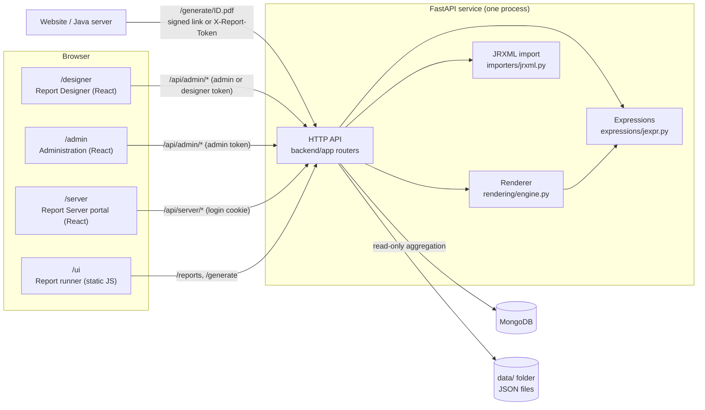

# Architecture — Mongo Reporting Service

A Jaspersoft Studio + JasperReports Server style reporting product, written in **Python (FastAPI)** and
**React**. Designers build band-based reports in the browser, save them in their own workspace, publish
them to a server repository, and users or other systems run them as PDF, Excel or CSV.

This document explains **what every part is, why it exists and how the parts work together**, and then the
**plan for making it production ready**. Keep it up to date when the structure changes.

---

## 1. The big picture



| Jaspersoft product | Here | Purpose |
|---|---|---|
| Jaspersoft Studio | `/designer` | Build reports: bands, elements, palette, outline, properties, query, preview, source |
| Workspace / project folder | `data/workspace/` | The designer's drafts. Saving never changes the server |
| JasperReports Server repository | `data/reports/` + `/server` | Published reports in folders; run, edit properties, copy/move, history |
| JRXML file | `.mrd` file | One file with the whole report (query, parameters, adapter, design, images) |
| Data Adapter | `data/connections.json` + `data/private_secrets.json` | Named database connections; secrets kept apart |
| JasperReports Library (Java) | `designer_render.py` + `jexpr.py` | Fills the design with data and draws PDF / Excel / CSV |

---

## 2. Repository layout

```text
backend/app/               The service (Python package) — see §3
app.py                     `uvicorn app:app` entry point (same app as `uvicorn backend.app.main:app`)
reporting_core.py          Compatibility module: re-exports the old names from backend.app (old imports and tests)
designer_render.py, jexpr.py, jrxml_import.py
                           Compatibility aliases for backend.app.rendering.engine / expressions.jexpr / importers.jrxml
reports/                   Built-in Python reports (optional, REPORTING_LOAD_BUILTIN_REPORTS)
frontend/                  React source (Vite, several pages) — see §4
  index.html, server.html, admin.html   page entry points → built into ui/app/
  src/ (designer)  src/server/  src/admin/  src/portal/ (shared shell, styles)
ui/                        What the service serves: index.html + runner.* (/ui, plain JS) and app/ (built React pages)
tests/                     pytest suite (≈240 tests) + JRXML fixture
data/                      Runtime data — never in git or in the Docker image (see §6)
.github/workflows/ci.yml   CI: ruff + pytest, frontend build, Docker build and start
pyproject.toml             Project metadata, ruff (lint) and pytest settings
requirements*.txt          Runtime / development dependencies
Dockerfile, .dockerignore  Multi-stage image: builds the frontend, then the Python service (no data inside)
seed_demo_data.py, check_local_mongo.py   Local helpers
.env.example               Every setting with a comment (copy to .env; .env is never committed)
DEPLOYMENT.md, README_roman_urdu.md, ARCHITECTURE.md   Documentation
```

---

## 3. Backend (`backend/app`)

```text
backend/app/
  main.py                  `app = make_app()` — the ASGI entry point
  factory.py               make_app(): builds the context, the FastAPI app, the access/log middleware, then each router
  context.py               create_context(): start-up work + shared state (settings, repository cache, Mongo clients)
                           and the helper functions endpoints share (require_admin, run_report_rows, record_history, …)
  routers/                 one module per area; each has register(app, ctx)
    pages.py               /, /ui, /admin, /designer, /server
    designer.py            query parse, JRXML import, design validate/render, draft preview/run, local bootstrap
    repository.py          /api/admin/reports…, /api/admin/folders… (token access)
    connections.py         /api/admin/connections… (data adapters)
    workspace.py           /api/admin/workspace… and Publish
    server_portal.py       /api/server/… (login session: repository, resources, copy/move, upload/download)
    users.py               /api/admin/users…
    system.py              /health, adapter status, whoami, logs, audit
    generate.py            /reports and /generate/<ID>.<format>
  config.py                Settings from environment variables
  constants.py             Patterns, roles, formats, cookie names, PROJECT_ROOT
  logs.py                  Logger, rotating log file, reading log entries
  security/                access.py (areas, client IP, admin IP allow-list) · secrets.py (private_secrets.json, .env)
                           · users.py (accounts, password hashes, session cookies)
  storage/                 files.py (data directory, folders, atomic JSON writes) · audit.py (run history)
  connectors/              mongodb.py (connection checks, run a pipeline) · profiles.py (data adapters and their
                           secrets) · mongo_fallback.py (in-process pipeline stages) · errors.py
  queries/mongo_query.py   Query parsing: Mongo shell / JSON / JS / Python, Jasper runCommand, $P{}, read-only checks
  definitions.py           ParameterSpec, ReportDefinition, saved JSON → definition, repository loader, parameter values
  mrd.py                   The .mrd file format
  rendering/
    engine.py              Design validation and the fill engine (PDF, pixel-perfect and table Excel/CSV)
    outputs.py             Simple table outputs and render_report_output() (band design or simple table)
  expressions/jexpr.py     Safe interpreter for Jasper's Java-like expressions
  importers/jrxml.py       Jaspersoft Studio .jrxml → report definition + design
  healthcheck.py           Container liveness probe
```

**How a request is served.** `make_app()` calls `create_context()` once: it reads the settings, prepares the data
folder, logging and the admin token, loads the repository into `reports_by_id`, and defines the shared helpers.
They are returned together as one `ctx` object. Each router's `register(app, ctx)` takes the helpers it needs from
`ctx` and adds its endpoints. Shared state (`reports_by_id`, `state`, `settings`) is changed in place, so every
router sees the same objects. Lower layers (`storage`, `security`, `connectors`, `queries`, `definitions`,
`rendering`) never import the routers or the context.

**Rules**

* A new endpoint goes into the router of its area; a helper used by several routers goes into `context.py`
  (later: a service module that takes `ctx`).
* To replace a function in tests, patch it where it is defined, e.g. `monkeypatch.setattr(core.mongodb,
  "MongoClient", Fake)`. Call sites reach `MongoClient`, `_execute_report_pipeline` and `_append_report_audit`
  through their module for exactly this reason.
* `ruff check .` (undefined/unused names, imports) and `pytest` must pass; CI runs both.

### 3.1 Responsibilities in more detail

| Part | What it does | Why |
|---|---|---|
| Settings, data directory | `Settings.from_env()`, `data_directory()` (`REPORTING_DATA_DIR`) | Everything is configured with environment variables; data lives in one mountable folder |
| Logs | Rotating `data/logs/service.log`, request logging middleware | Admins read logs on `/admin → Logs` without server access |
| Access policy | Enabled areas (`REPORTING_ENABLED_AREAS`), admin IP allow-list, trusted proxies | The same image can run as a public runner or an internal designer instance |
| Users and sessions | PBKDF2 password hashes in `users.json`, signed HttpOnly session cookie, roles viewer/designer/admin, lockout after failed logins | `/server` needs real user accounts like JasperReports Server |
| Query parsing | Mongo shell / aggregation JSON / JavaScript / Python pipeline literal, Jasper `runCommand` and `collectionName/findQuery`, `$P{}` → parameters, read-only stage check | Designers paste their Jasper queries unchanged; nothing in a query can write to the database |
| Report definitions | `_dynamic_report()` turns saved JSON into a `ReportDefinition` (parameters, columns, pipeline builder); `discover_reports()` loads the repository | One validated, in-memory object per published report |
| Connections | `load_connection_profiles()`, `_profile_credentials()`, `get_connection()` (cached `MongoClient`s) | Adapter names are public; URLs/passwords stay in `private_secrets.json` or environment variables |
| Outputs | `render_report_output()` picks the band designer or the simple table output; subreport loader | `/generate`, `/server` and the admin "Run" share one code path |

### 3.2 `rendering/engine.py` — filling and drawing a design

* `validate_design(design, columns, parameter_names)` — the only gate for a design. It rebuilds every element
  from an allow-list (types, sizes, colours, fonts, expressions, images ≤ 2.5 MB), so the renderer only ever
  sees clean data. Unknown `$F/$P/$V` names are refused here, not at run time.
* `_Render` — Jasper's fill engine, simplified:
  * rows → calculated fields → **dataset filter expression** → sort → groups;
  * variables (Sum/Count/Average/Min/Max/First, reset per report or group);
  * bands in Jasper order: Background, Title, Page Header, Column Header, group headers, Detail, group
    footers, Column Footer, Page Footer / Last Page Footer, Summary, No Data;
  * report properties: When No Data Type, Title / Summary on a new page, Float column footer, Ignore pagination;
  * stretch-with-overflow, Print When, Evaluation Time (two passes so "Page X of Y" and report totals are right);
  * components that print many records — **Table, Crosstab, List, Subreport** — expand into rows, break
    across pages and repeat their header.
* Outputs: `render_design_pdf` (ReportLab), `render_grid_xlsx/csv` (pixel-perfect: every printed element in
  its cell, merged like Jasper's XLSX exporter), `render_design_xlsx/csv` in table mode (one row per record).

### 3.3 `expressions/jexpr.py` — expressions

A small tokenizer + parser + evaluator for the Java subset Jasper reports use (`$F{A}.equals("x")`,
`new SimpleDateFormat(...)`, ternaries, `DecimalFormat`, `Math`, `String` and `Date` methods). It never calls
Python `eval`; unknown methods are errors. Used for text fields, Print When, filters, computed parameters.

### 3.4 `importers/jrxml.py`

Reads a `.jrxml` (bands, static/text fields, lines, rectangles, images, groups, variables, parameters,
MongoDB query) and returns our report + design plus a list of warnings for what could not be converted.

### 3.5 HTTP API (the routers)

| Group | Paths | Who |
|---|---|---|
| Report access | `/generate/{ID}.{pdf,xlsx,csv}`, `/reports`, `/reports/connections/{id}/status` | Websites (signed link, `X-Report-Token`) or admin token |
| Pages | `/designer`, `/server`, `/admin`, `/ui` | Browser |
| Designer workspace | `/api/admin/workspace…`, `/publish` | Designer or admin token |
| Designer tools | `/api/admin/query/parse`, `/designer/render`, `/designer/validate`, `/drafts/preview`, `/drafts/run`, `/jrxml/import` | Designer or admin token |
| Repository (token) | `/api/admin/reports…`, `/api/admin/folders…` | Designer (read/save), admin (delete) |
| Data adapters | `/api/admin/connections…` | Admin (change), designer (list/test) |
| `/server` portal | `/api/server/login`, `/repository`, `/reports/{id}` (details, edit, copy, move, file, run), `/upload`, `/folders…`, `/connections` | Session cookie; viewer < designer < admin |
| Administration | `/api/admin/users…`, `/logs…`, `/audit`, `/whoami` | Admin token |
| Health | `/health` | Open |

---

## 4. Frontend

Built with Vite into `ui/app/` (`cd frontend && npm run build`). Three React pages share `ContextMenu`,
`portal/Shell` and the API helpers.

### 4.1 Designer (`frontend/src`)

| File | Responsibility |
|---|---|
| `App.jsx` | Layout (left docks, tabs Setup / Design / Source / Preview, right docks), keyboard shortcuts, dialogs, save / publish / open file |
| `store.js` | Reducer: report fields, design, undo/redo history, selection, armed palette tool |
| `designModel.js` | Pure functions on the design JSON: bands, elements, defaults, palette, rename/refactor |
| `arrange.js` | Multi-select, align/distribute/size, clipboard, snapping and smart guides |
| `templates.js`, `TemplateGallery.jsx` | Layout templates: blank, letter, table, form, certificate |
| `Canvas.jsx` | Visual editor: bands, elements, drag/resize, rulers, guides, rubber band, arrange toolbar |
| `panels.jsx` | Workspace, Server and Data Adapters trees, Outline, Palette, adapter wizard, database logos |
| `outlineActions.js` | Every right-click menu (report, band, element, parameter, field, variable, canvas) |
| `Properties.jsx`, `ComponentProps.jsx` | Property tabs for the report, bands, elements and data components |
| `SetupForm.jsx`, `DatasetQueryDialog.jsx` | Report details, data adapter, query, fields, parameters, filter and sort |
| `ComponentWizard.jsx`, `ExpressionEditor.jsx`, `PublishDialog.jsx` | Table/Crosstab/Subreport wizards, expression editor, publish |
| `SourceView.jsx`, `mrd.js` | Source tab (definition as JSON, validated Apply) and the `.mrd` file format |
| `Preview.jsx` | Runs the draft on a data adapter and shows/exports the result |
| `api.js` | Token-based fetch helper for `/api/admin/*` |

### 4.2 `/server` (`frontend/src/server`)

`ServerApp` (login, folder tree, report list, right-click menus, clipboard), `ResourcePanel` (Run · Overview ·
Parameters · Data Source · Query · History), `UploadDialog` (Add Resource), `RunPanel`, `serverApi` (cookie session).

### 4.3 `/admin` (`frontend/src/admin`)

Overview, Users (accounts and roles), Data sources (adapters), Logs (service log + run history).

---

## 5. The data model

**Report definition** (what is saved, published and put in a `.mrd` file):

```json
{
  "id": "BRANCH_REPORT", "title": "Branch report", "description": "", "folder": "Finance",
  "connectionId": "default", "collection": "Orders",
  "queryLanguage": "mongosh", "querySource": "db.Orders.aggregate([...])",
  "parameters": [{ "name": "StartDate", "type": "date", "label": "Start date", "required": true }],
  "columns": ["Branch", "Amount"],
  "formats": ["pdf", "xlsx", "csv"], "defaultFormat": "pdf",
  "design": {
    "page": { "width": 595, "height": 842, "margins": {}, "sheetLayout": "grid", "whenNoDataType": "Auto" },
    "calculatedFields": [], "groups": [], "variables": [], "sort": [], "filterExpression": "",
    "bands": { "title": {"height": 50, "elements": []}, "detail": {}, "groupHeaders": {}, "groupFooters": {} }
  }
}
```

**`.mrd` file** = that JSON inside `<mongoReportDefinition version="1"><definition encoding="json">…</definition></mongoReportDefinition>`.
The Source tab shows and edits exactly this JSON (pictures shortened to `@image:<id>`).

*Why JSON and not JRXML?* The engine is not the Java JasperReports library, so a JRXML we wrote could not be
run by Jasper anyway and would hide features (subreports with their own query, pixel-perfect grid export) or
lose ours. JRXML is supported **in** (import); `.mrd` is the native format, like `.jrxml` is for Jasper.

---

## 6. Storage on disk (`REPORTING_DATA_DIR`, default `./data`)

| Path | Content | In git? |
|---|---|---|
| `reports/<folder>/<ID>.json` | Published reports (the server repository) | No |
| `workspace/<folder>/<ID>.json` | Designer drafts (+ publish status) | No |
| `folders.json` | Repository folder list | No |
| `connections.json` | Data adapter names, folders, how to find their secrets | No |
| `private_secrets.json` | Admin token (local use), adapter URLs/passwords | **Never** |
| `users.json` | `/server` accounts (password hashes) | **Never** |
| `history/<ID>.json` | What happened to each server report | No |
| `audit/`, `logs/` | Run history, service log | No |

Writes go through `_write_json_atomically` (temp file + rename), so a crash never leaves half a file.

---

## 7. Main flows

1. **Design** → Setup (name → ID, adapter, query, *Read fields*) → choose a layout template or design freely
   → **Save** writes `workspace/…` only.
2. **Preview** → `/api/admin/drafts/preview` runs the draft's query (first 20 records) → `/designer/render` →
   PDF in the viewer; Export uses the same data.
3. **Publish** → the workspace JSON is validated and copied to `reports/<folder>/` → `reports_by_id` cache
   updated → history `published`.
4. **Run** (`/server`, `/generate`, admin Run) → parameters validated → pipeline built with the values →
   MongoDB (read-only, row and time limits) → `render_report_output` → file + audit record.
5. **Subreport** → while filling, the subreport element's parameter expressions are evaluated → the published
   subreport runs its own query (cached per parameter set, ≤ 200 runs) → its bands are drawn in place.

---

## 8. Security model (summary — details in DEPLOYMENT.md)

* Three credentials: admin token, designer token, report-access secret (signed links / header).
* `/server` users with roles; sessions are HMAC-signed HttpOnly cookies (key: `REPORTING_SESSION_SECRET`, else
  derived from the admin token), revoked on logout and password change.
* Areas can be switched off per instance; admin pages can be limited to IP ranges.
* Queries are parsed as data and checked to be read-only; expressions are interpreted, never executed.
* Secrets never leave the server (adapter pages show "URL saved", not the URL) and never enter git.

---

## 9. Making it production ready

### 9.1 Gaps found today

| Gap | Risk | Fix |
|---|---|---|
| ~~`reporting_core.py` is 4 300 lines~~ | — | **Done:** split into `backend/app` (§3), behaviour unchanged, all tests green |
| State in process memory (`reports_by_id`, Mongo clients) and JSON files | Only **one** worker can run; no horizontal scaling | Move repository, workspace, users, history to a database (PostgreSQL) with a cache layer |
| ~~Dockerfile copied files that are not in git~~ | — | **Done:** multi-stage image from a clean checkout, no `data/` inside, liveness probe |
| Only MongoDB adapters | Cannot report on SQL databases | Connector layer (§9.3) |
| One dataset per report | Tables/charts cannot have their own query like Jasper's `Dataset1` | Sub-datasets (§9.4) |
| Large reports run inside the HTTP request | Timeouts, blocked workers | Background jobs with a queue, download when ready, scheduling |
| No report versions (history records actions, not content) | Cannot roll back a bad publish | Store each published version; "Restore" on the History tab |
| ~~No CI pipeline~~ | — | **Done:** `.github/workflows/ci.yml` — ruff, pytest, frontend build, Docker build and start |
| Metrics only in logs | No alerting | `/metrics` (Prometheus), readiness probe that checks storage and adapters |

### 9.2 Target structure

**Status:** the backend part is done (see §3: routers, security, storage, connectors, queries, rendering,
expressions, importers). Still to do: `services/` (the helpers now in `context.py`), a database backend for
`storage/`, the SQL connector, `frontend/apps` + `frontend/shared`, and moving deployment files into `deploy/` and
the guides into `docs/`.

```text
backend/
  app/
    main.py                 create_app(): routers, middleware, lifespan
    config.py               Settings (pydantic-settings) — the environment variables
    security/               tokens, roles, sessions, signed links, ip policy
    api/                    one router per area: generate, designer, workspace, repository,
                            server_portal, connections, users, logs, health
    services/               report_service, publish_service, run_service, history_service
    connectors/             base.py (Connector protocol), mongodb.py, sql.py (PostgreSQL, MySQL,
                            SQL Server, Oracle via SQLAlchemy), registry.py
    queries/                mongo query parsing, Jasper runCommand, read-only checks, SQL checks
    rendering/              design_model.py (validate), fill.py (_Render), components.py
                            (table, crosstab, list, subreport), pdf.py, grid.py, tabular.py
    expressions/            jexpr.py
    importers/              jrxml.py
    storage/                repository.py, workspace.py, users.py, history.py
                            (file backend today, database backend next — same interface)
  tests/
frontend/
  apps/designer, apps/server, apps/admin, apps/runner
  shared/                   api clients, ContextMenu, Shell, styles, DbLogo
deploy/
  Dockerfile, docker-compose.yml (service + MongoDB + PostgreSQL), nginx.conf, k8s/ (optional)
docs/
  ARCHITECTURE.md, DEPLOYMENT.md, USER_GUIDE (Roman Urdu), API (OpenAPI)
.github/workflows/ci.yml
```

Rules for the split: no behaviour change in the same pull request, tests stay green after every step, the
public URLs and the JSON formats (report definition, design, `.mrd`) stay the same.

### 9.3 Database connectors (PostgreSQL, MySQL/MariaDB, SQL Server, Oracle)

```python
class Connector(Protocol):
    kind: str                                    # "mongodb", "postgresql", …
    def test(self) -> str: ...
    def parse(self, source: str, language: str) -> ParsedQuery: ...   # fields, parameter names, read-only check
    def run(self, query: ParsedQuery, params: dict, *, max_rows: int, timeout_ms: int) -> list[dict]: ...
```

* SQL adapters use SQLAlchemy with the official drivers (psycopg, PyMySQL, pyodbc / mssql, oracledb).
* Only `SELECT` / `WITH … SELECT` are allowed; `$P{Name}` becomes a bound parameter (`:Name`), never text.
* Fields come from the result description (`LIMIT 0` / `TOP 0`), like Jasper's "Read Fields".
* Adapters get a `type`; the designer already shows each type's logo and the wizard lists the planned types.
* The run path (`render_report_output`, subreports, preview) calls the connector registry instead of MongoDB directly.

### 9.4 Sub-datasets and the Table editor (Jasper's `Dataset1` and the "Table" tab)

* `design.datasets = [{ name, connectionId?, query, parameters, fields }]`; Table / List / Crosstab / Chart get
  `dataset: "Dataset1"` and a parameter map, exactly like Jasper's dataset run.
* The Table wizard gets the first page from the screenshot: *new dataset* or *existing dataset*.
* Double-clicking a Table opens its own editor tab (like *Main Report | Table*): header / detail / footer cells
  as real elements (fonts, borders, Print When per cell), column groups, drag to resize.

### 9.5 Suggested order

1. ~~CI + backend split~~ — **done**. Next small step: move the helpers in `context.py` into service modules.
2. Connector layer + PostgreSQL first (then MySQL, SQL Server, Oracle).
3. Sub-datasets + Table editor tab.
4. Database storage, report versions, several workers.
5. Background jobs, scheduling and e-mail (JasperReports Server "Schedule"), metrics and alerts.
